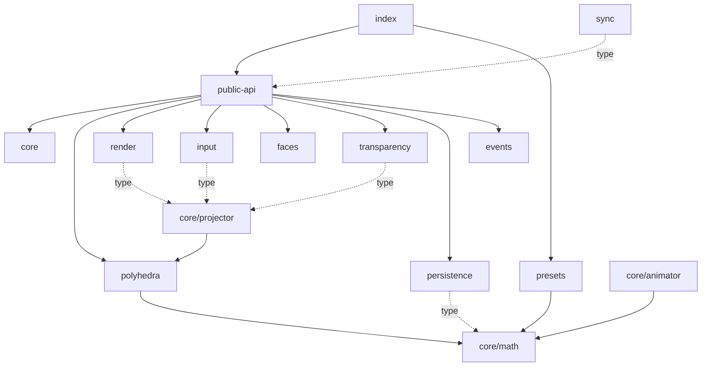

# Architecture audit — PolyFaceLib

Date: 2026-10-30 · Commit: 0b6e7d3 · Branch: main

Output language: English (chosen by the user).

## Summary

PolyFaceLib is a zero-runtime-dependency TypeScript library (35 source files, 3,537 lines in `src/`) that projects DOM elements onto the faces of a convex polyhedron. It is already organised by domain (`core/`, `polyhedra/`, `input/`, `render/`, `faces/`, `transparency/`, `persistence/`, `sync/`) and has no file-level import cycle. The one structural defect is a **directory-level cycle between `core/` and `polyhedra/`**: `polyhedra/` depends on `core/math/`, while `core/projector.ts` depends on `polyhedra/`. The vector/quaternion math is a leaf that both sit on, but it lives inside one of them. The rest of the problems are tooling and documentation gaps, not structure. A restructuring is worth doing only in a small form: lift `core/math/` to `src/math/`. A larger reorganisation would be churn without benefit.

## Current layout

```
src/
├── index.ts               # public barrel (tsup entry "index")
├── public-api.ts          # PolyFaceLib class (657 lines)
├── events.ts              # Emitter used by public-api
├── styles.css             # copied to dist/ by tsup onSuccess
├── core/
│   ├── math/              # vec3, vec4, mat4, quat, projection, index.ts (unused barrel) ⚠ leaf module nested in a higher-level one
│   ├── projector.ts       # imports polyhedra/ ⚠ (other half of the core↔polyhedra cycle)
│   ├── animator.ts
│   └── frame.ts           # rAF loop
├── polyhedra/
│   ├── polyhedron.ts, adjacency.ts, orientations.ts, transitions.ts
│   ├── index.ts           # unused barrel ⚠
│   └── presets/           # cube … prism, index.ts (tsup entry "presets")
├── input/                 # pointer, keyboard, controls, zones
├── render/                # stage, clip, responsive
├── faces/face-content.ts
├── transparency/depth-opacity.ts
├── persistence/persistence.ts
└── sync/sync.ts
tests/                     # 7 vitest files, mirror tree importing ../src/…
examples/                  # 15 static HTML demos importing ../dist/index.js
scripts/serve-examples.mjs # builds, then serves the repo root
```

## Stack and conventions observed

- Languages / frameworks: TypeScript 5 (`strict`, `moduleResolution: Bundler`), plain DOM, no runtime dependencies.
- Build / packaging: tsup, two entries (`src/index.ts`, `src/polyhedra/presets/index.ts`), ESM + CJS + bundled `.d.ts`; `exports` map `.`, `./styles.css`, `./presets`.
- Tests: vitest + jsdom, `tests/**/*.test.ts`, 83 tests passing (vitest count; `grep` of `it(` gives 44 because of parametrised tests).
- CI: none in the repository.
- Conventions already followed (keep these): kebab-case file names, one folder per domain, `pf-` CSS prefix, pure math separated from DOM code, tests in a mirror tree.

## Dependency picture



- Cycles: none at file level (`madge --circular`, evidence `restructure-evidence/madge-circular.txt`). One at directory level, `core/ ↔ polyhedra/` (evidence `restructure-evidence/dir-cycle-core-polyhedra.txt`).
- Hub modules: `core/math/vec3.ts` and `quat.ts` (imported by `core/`, `polyhedra/`, `presets/`, `persistence/`, tests); `public-api.ts` (imports 18 distinct modules).
- Entry points: `src/index.ts`, `src/polyhedra/presets/index.ts` (tsup), `scripts/serve-examples.mjs` (npm `examples`).

## Integration points that pin paths

| Where | What it references | Kind |
|---|---|---|
| tsup.config.ts:6–7 | `src/index.ts`, `src/polyhedra/presets/index.ts` | build entries |
| tsup.config.ts:23 | `src/styles.css` (copied to `dist/styles.css`) | build asset |
| package.json `main`/`module`/`types`/`exports`/`files` | `./dist/index.*`, `./dist/presets.*`, `./dist/styles.css` | public contract (build output names, not source paths) |
| package.json `scripts` | `scripts/serve-examples.mjs`, `typedoc src/index.ts`, `src/**/*.{ts,tsx,css}` | scripts |
| tsconfig.json | `include: src/**/*`, `rootDir: ./src`, `outDir: ./dist` | compiler |
| vitest.config.ts | `tests/**/*.test.ts`, coverage `src/**/*.ts`, excludes `src/index.ts`, `src/public-api.ts` | test runner |
| tests/*.test.ts | 22 relative imports into `../src/…` (7 into `core/math/`) | test imports |
| examples/*.html (14 files) | `../dist/index.js`, `../dist/styles.css`, `./_shared.css` | static pages |
| scripts/serve-examples.mjs:14 | repo root via `new URL('..', import.meta.url)` | runtime path |
| CONTRIBUTING.md:55–64, 103, 115, 139, 207 | `src/core/math/`, `src/polyhedra/…`, `src/render/` | docs |
| SPECIFICATION.md:45–84 | full `src/` tree | docs |

No dynamic `import()`, no string-built module paths, no `tsconfig` `paths` aliases.

## Findings

### F1 — Directory cycle between `core/` and `polyhedra/`
- **Where:** `src/core/projector.ts:8–10` → `polyhedra/`; `src/polyhedra/{polyhedron,orientations,transitions}.ts` and `presets/{dodecahedron,icosahedron,prism}.ts` → `core/math/`.
- **What:** the math primitives every layer uses are nested inside `core/`, which also holds the projector that sits above `polyhedra/`.
- **Why it matters:** CONTRIBUTING describes `core/` and `polyhedra/` as layers, but neither can be understood, tested or extracted without the other. Anyone adding to `core/` cannot tell whether they are allowed to import from `polyhedra/`.
- **Suggested direction:** move `src/core/math/` to `src/math/`. Dependency order becomes `math ← polyhedra ← core ← render/input ← public-api`, with no cycle.

### F2 — Project-layout documentation contradicts the code
- **Where:** CONTRIBUTING.md:52–64, SPECIFICATION.md:45–84.
- **What:** CONTRIBUTING omits `persistence/`, `sync/`, `events.ts`, `styles.css`; SPECIFICATION lists `faces/text.ts`, `image.ts`, `html.ts`, `component.ts`, which do not exist (all content types live in `faces/face-content.ts`). CONTRIBUTING calls `public-api.ts` "public exports"; that role is `index.ts`, `public-api.ts` holds the `PolyFaceLib` class.
- **Why it matters:** the layout section is what a contributor reads first.
- **Suggested direction:** update both trees during the migration (doc edit, no behaviour change).

### F3 — Two unused barrel files
- **Where:** `src/core/math/index.ts`, `src/polyhedra/index.ts`.
- **What:** `madge --orphans` lists both (plus `index.ts`, which is the tsup entry); `grep` finds no import of either in `src/`, `tests/`, `examples/`, `scripts/`, and neither is a tsup entry.
- **Why it matters:** two ways to import the same symbols, one of them dead. See "Dead-code candidates".

## Dead-code candidates (not removed)

- `src/core/math/index.ts` — no reference (evidence `restructure-evidence/madge-orphans.txt`).
- `src/polyhedra/index.ts` — no reference (same evidence). Possibly intended as a future `./polyhedra` subpath export; the author should decide.

## Additional recommendations

### R1 — `npm run lint` cannot run
- **Evidence:** `restructure-evidence/lint-before.txt`: ESLint 10.1.0 (a global install; `eslint` is not in `devDependencies`) fails with "couldn't find an eslint.config.(js|mjs|cjs) file". No ESLint config exists in the repo; `--ext` was removed in ESLint 9.
- **Proposal:** add `eslint` + `typescript-eslint` to `devDependencies`, an `eslint.config.js`, and drop `--ext .ts`.
- **Impact / what could go wrong:** a first run will report findings that were never enforced, contrary to what CONTRIBUTING states.
- **How to verify afterwards:** `npm run lint` exits 0 or reports a stable count.
- **Value / risk:** med / low · **Behaviour:** preserving.

### R2 — `npm run test:coverage`, `format`, `docs` depend on missing packages
- **Evidence:** `restructure-evidence/test-coverage.txt` ("MISSING DEPENDENCY @vitest/coverage-v8"); `prettier` and `typedoc` are absent from `package.json` `devDependencies` (they only resolve when globally installed).
- **Proposal:** add `@vitest/coverage-v8`, `prettier`, `typedoc` to `devDependencies`.
- **Impact:** lockfile change only.
- **How to verify:** each script runs after `npm ci` on a clean machine.
- **Value / risk:** med / low · **Behaviour:** preserving.

### R3 — No CI
- **Evidence:** no `.github/`, `.gitlab-ci.yml` or equivalent in the tree (`inventory.json`).
- **Proposal:** one workflow running `npm ci && npm run typecheck && npm test && npm run build`.
- **Value / risk:** high / low · **Behaviour:** preserving.

### Suspected, not confirmed
- `src/core/frame.ts` uses `requestAnimationFrame` (guarded by `typeof`), which slightly contradicts "core knows nothing about the DOM". Whether it should move to `render/` is a design call; it would not affect behaviour — settled by asking the author.
- `public-api.ts` (657 lines) concentrates lifecycle, navigation, persistence wiring and rendering in one class. Splitting it is a logic refactor, out of scope — settled by a coverage report (needs R2) showing which parts are untested before any split.

## Recommended changes, prioritized

1. Move `src/core/math/` → `src/math/` (F1) — impact med, risk low.
2. Update layout sections of CONTRIBUTING and SPECIFICATION (F2) — impact med, risk none.
3. R3, R1, R2 as separate tasks — impact med–high, risk low.
4. Decide on the two unused barrels (F3) — impact low, risk low.
